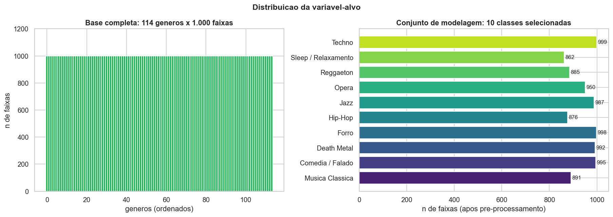
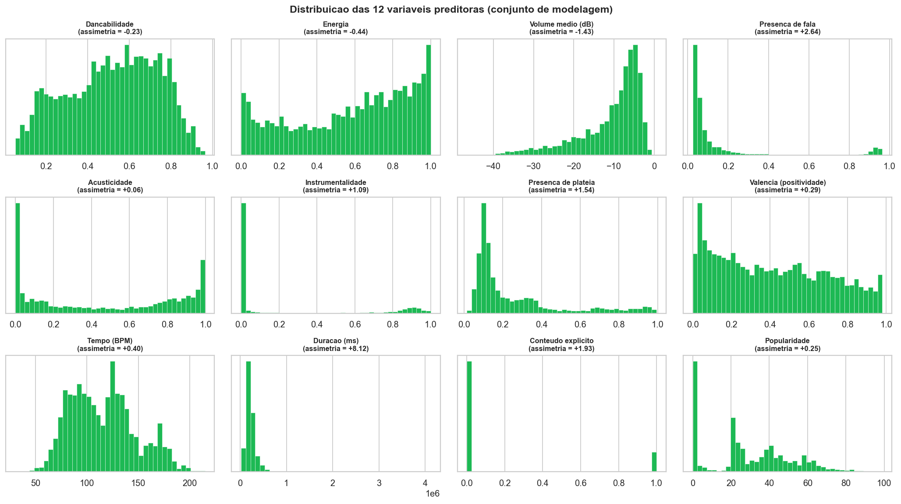
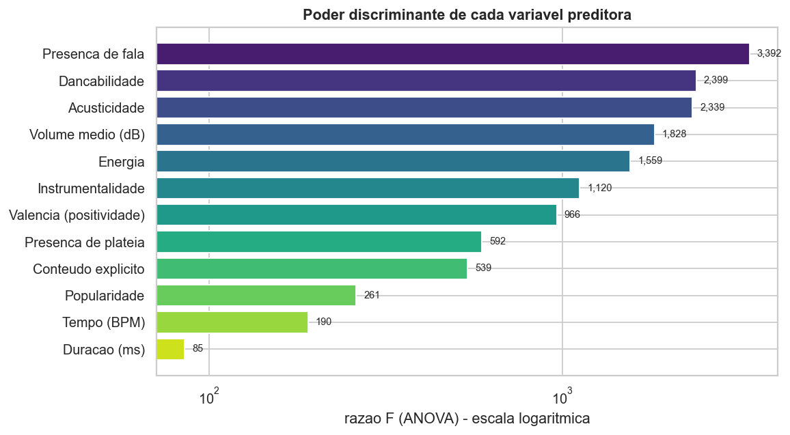
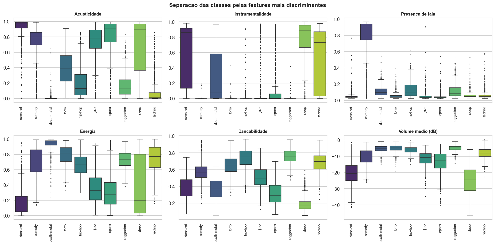
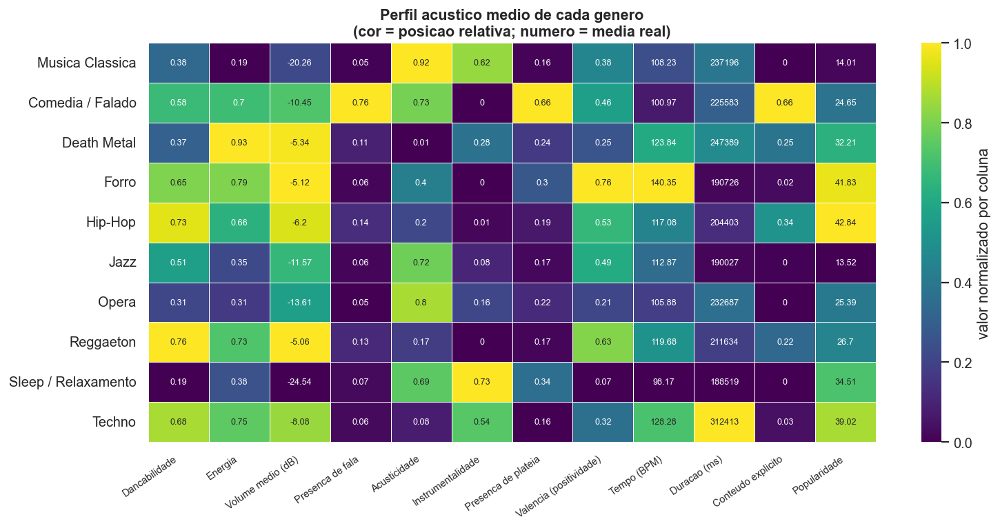
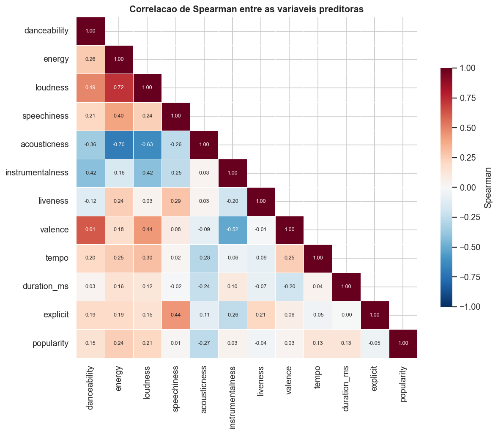
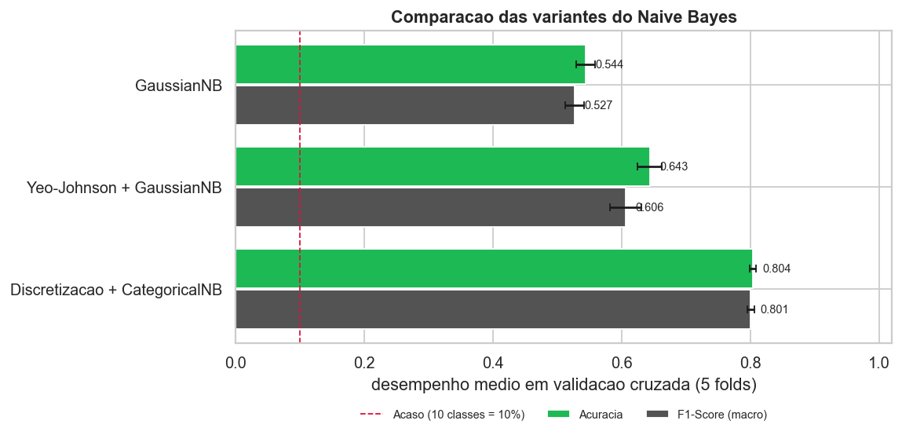
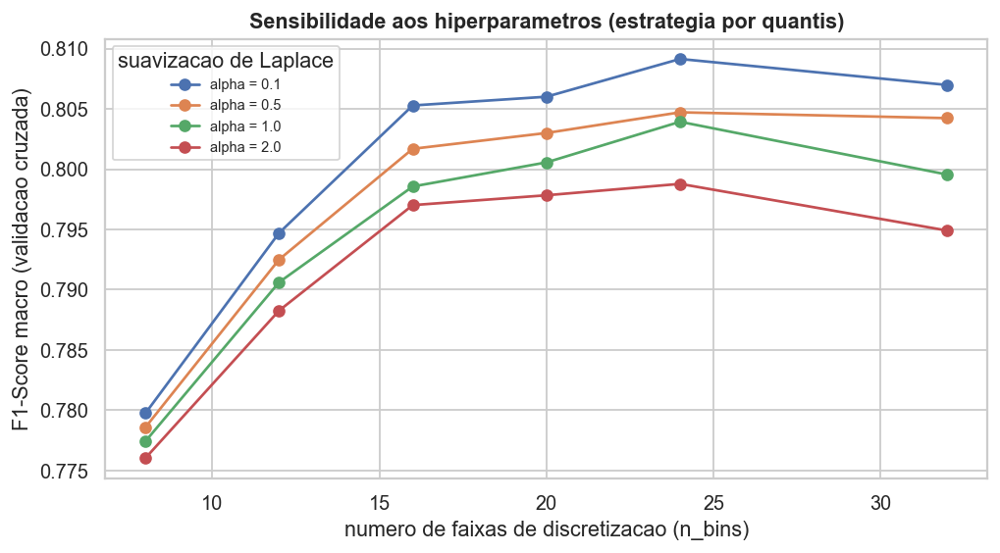
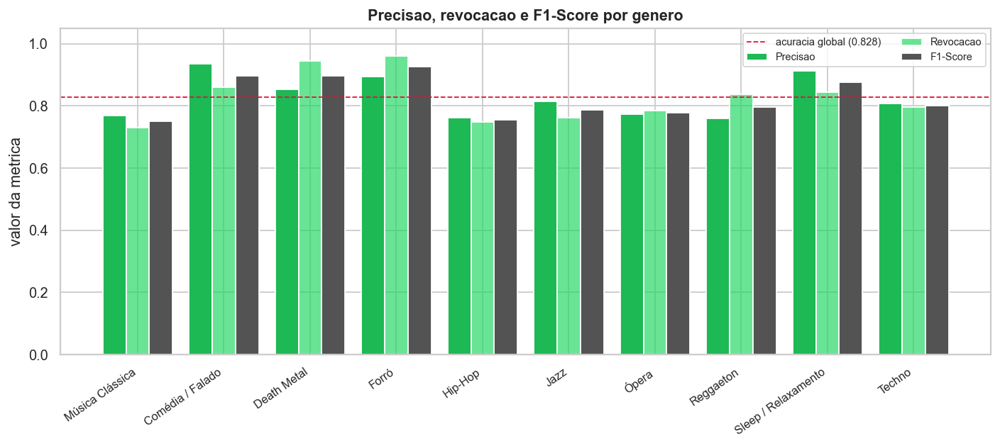
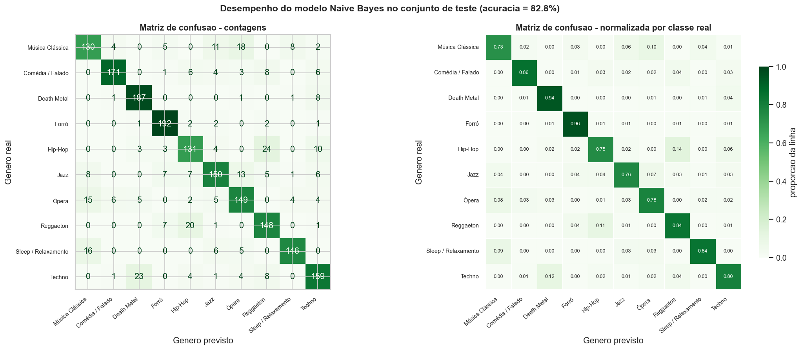

# Relatório Técnico

## Classificação Supervisionada de Gêneros Musicais com Naive Bayes

**Disciplina:** Probabilidade e Estatística
**Curso:** Engenharia da Computação — Instituto Federal do Ceará (IFCE)
**Professor:** Valberto Feitosa
**Base de dados:** Spotify Tracks Dataset (Kaggle)

---

## Sumário

1. [Objetivo](#1-objetivo)
2. [A base de dados](#2-a-base-de-dados)
3. [Definição do problema de classificação](#3-definição-do-problema-de-classificação)
4. [Análise exploratória dos dados](#4-análise-exploratória-dos-dados)
5. [Pré-processamento](#5-pré-processamento)
6. [Seleção e justificativa das variáveis](#6-seleção-e-justificativa-das-variáveis)
7. [Treinamento do modelo](#7-treinamento-do-modelo)
8. [Avaliação do modelo](#8-avaliação-do-modelo)
9. [Salvamento do modelo](#9-salvamento-do-modelo)
10. [A aplicação web](#10-a-aplicação-web)
11. [Limitações e trabalhos futuros](#11-limitações-e-trabalhos-futuros)
12. [Conclusão](#12-conclusão)

---

## 1. Objetivo

Desenvolver uma solução completa de *Machine Learning* para um problema de
**classificação supervisionada**, abrangendo desde a análise da base de dados
até a disponibilização do modelo treinado em uma aplicação web interativa.

A pergunta que o sistema responde é:

> A partir das características acústicas de uma faixa musical, qual é o seu
> gênero?

O algoritmo utilizado é o **Naive Bayes**, conforme exigido pelo enunciado.

---

## 2. A base de dados

### 2.1. Origem

A base escolhida é o **Spotify Tracks Dataset**, disponível publicamente no
Kaggle:

> https://www.kaggle.com/datasets/maharshipandya/-spotify-tracks-dataset

Os atributos acústicos foram extraídos pela própria API do Spotify, que calcula
indicadores como dançabilidade, energia e acusticidade a partir do áudio.

### 2.2. Características principais

| Característica | Valor |
|---|---|
| Quantidade de observações | **114.000 faixas** |
| Quantidade de colunas | 20 |
| Colunas de identificação | 4 (`track_id`, `artists`, `album_name`, `track_name`) |
| Variáveis preditoras candidatas | 15 |
| Variável-alvo | `track_genre` (categórica) |
| Classes na variável-alvo | **114 gêneros** |
| Faixas por gênero | exatamente 1.000 (base balanceada) |
| Valores ausentes | 3 (uma única faixa, nas colunas descritivas) |

### 2.3. Dicionário das variáveis

| Variável | Tipo | Descrição |
|---|---|---|
| `popularity` | inteiro (0–100) | Índice de popularidade da faixa |
| `duration_ms` | inteiro | Duração em milissegundos |
| `explicit` | booleano | Indica letra explícita |
| `danceability` | real (0–1) | Adequação da faixa para dançar |
| `energy` | real (0–1) | Intensidade e atividade percebidas |
| `key` | inteiro (0–11) | Tonalidade da faixa |
| `loudness` | real (dB) | Volume médio |
| `mode` | binário | Modo maior (1) ou menor (0) |
| `speechiness` | real (0–1) | Proporção de palavras faladas |
| `acousticness` | real (0–1) | Confiança de que a faixa é acústica |
| `instrumentalness` | real (0–1) | Confiança de que não há vocais |
| `liveness` | real (0–1) | Indício de gravação com plateia |
| `valence` | real (0–1) | Positividade musical transmitida |
| `tempo` | real (BPM) | Andamento estimado |
| `time_signature` | inteiro | Fórmula de compasso estimada |
| `track_genre` | **categórica** | **Variável-alvo: gênero musical** |

A base é adequada ao trabalho porque possui uma **variável-alvo categórica** e
variáveis preditoras numéricas que permitem a aplicação do Naive Bayes em um
problema de classificação supervisionada.

---

## 3. Definição do problema de classificação

### 3.1. O problema dos 114 gêneros

Uma análise direta dos rótulos revela que os 114 gêneros **não são mutuamente
exclusivos do ponto de vista acústico**. A base contém, por exemplo:

> `rock`, `hard-rock`, `punk-rock`, `alt-rock`, `rock-n-roll`, `punk`,
> `grunge`, `emo`, `indie`, `indie-pop`, `alternative`, `psych-rock`,
> `power-pop`…

Esses são rótulos **comerciais** de catálogo, não categorias acústicas
distintas. Além disso, **24.259 faixas (`track_id`) aparecem em mais de um
gênero** na base original — a mesma música rotulada de formas diferentes.

Nenhum classificador consegue separar classes cujos rótulos se sobrepõem.

### 3.2. Experimento de validação da escolha

Para fundamentar a decisão com evidência, e não com opinião, o script
`src/00_justificativa_subconjunto.py` aplica **o mesmo algoritmo, as mesmas
features e os mesmos hiperparâmetros** a três recortes diferentes:

| Recorte | Classes | Faixas | Acurácia | F1-macro | Ganho sobre o acaso |
|---|---|---|---|---|---|
| (a) Todos os gêneros originais | 114 | 113.392 | 0,2726 | 0,2535 | 31,1× |
| (b) 10 gêneros **próximos** (rock e variações) | 10 | 6.160 | 0,5438 | 0,4917 | 5,4× |
| (c) 10 gêneros **contrastantes** (adotado) | 10 | 9.435 | **0,8283** | **0,8261** | 8,3× |

A leitura é decisiva:

* O recorte **(a)** mostra que o modelo aprende de verdade (31× melhor que o
  acaso), mas a acurácia absoluta de 27 % é baixa demais para uma aplicação
  útil.
* O recorte **(b)** prova que **o problema não é a quantidade de classes**:
  com apenas 10 rótulos, porém sobrepostos, o desempenho permanece fraco
  (54 %).
* O recorte **(c)** mantém 10 classes e atinge 83 %, porque os gêneros ocupam
  regiões distintas do espaço de atributos.

**Conclusão:** o fator limitante é a *definição das classes*, não o algoritmo.

### 3.3. Classes adotadas

O trabalho adota um problema de **classificação multiclasse com 10 gêneros
acusticamente contrastantes**:

| Gênero | Rótulo | Justificativa da inclusão |
|---|---|---|
| `classical` | Música Clássica | Alta acusticidade, baixa energia |
| `comedy` | Comédia / Falado | `speechiness` muito alta (conteúdo falado) |
| `death-metal` | Death Metal | Energia máxima, acusticidade quase nula |
| `forro` | Forró | Gênero brasileiro, alta dançabilidade e valência |
| `hip-hop` | Hip-Hop | Fala moderada, dançabilidade alta |
| `jazz` | Jazz | Acústico, energia intermediária |
| `opera` | Ópera | Vocal acústico, baixa dançabilidade |
| `reggaeton` | Reggaeton | Dançabilidade máxima, ritmo marcado |
| `sleep` | Sleep / Relaxamento | Energia e volume mínimos, instrumental |
| `techno` | Techno | Eletrônico instrumental, faixas longas |

O conjunto cobre música instrumental e vocal, acústica e eletrônica, calma e
agressiva, além de incluir um gênero brasileiro (`forro`) e um caso-limite de
conteúdo falado (`comedy`).

---

## 4. Análise exploratória dos dados

> Script: `src/01_analise_exploratoria.py`
> Figuras: `relatorio/figuras/` · Tabelas: `resultados/`

### 4.1. Distribuição das classes



A base original é **perfeitamente balanceada**: 1.000 faixas por gênero. Após
o pré-processamento, o conjunto de modelagem mantém entre 862 e 999 faixas
por classe, com coeficiente de variação de apenas **6,16 %**.

**Implicações estatísticas:**

* A **acurácia é uma métrica confiável** (não há classe dominante que a
  inflacione artificialmente);
* A linha de base do acaso é 1/10 = **10 %**;
* As **médias macro** de precisão, revocação e F1 são representativas, pois
  todas as classes têm peso semelhante.

### 4.2. Estatísticas descritivas

Estatísticas das 12 variáveis preditoras no conjunto de modelagem
(`resultados/aed_estatisticas_features.csv`):

| Variável | Média | Desvio | Mín | Mediana | Máx | Assimetria |
|---|---|---|---|---|---|---|
| `danceability` | 0,519 | 0,216 | 0,051 | 0,537 | 0,964 | −0,23 |
| `energy` | 0,585 | 0,305 | 0,000 | 0,652 | 1,000 | −0,44 |
| `loudness` | −10,845 | 7,828 | −46,591 | −8,033 | 0,550 | **−1,43** |
| `speechiness` | 0,150 | 0,241 | 0,024 | 0,054 | 0,965 | **+2,64** |
| `acousticness` | 0,468 | 0,383 | 0,000 | 0,449 | 0,996 | +0,06 |
| `instrumentalness` | 0,237 | 0,371 | 0,000 | 0,000 | 1,000 | **+1,09** |
| `liveness` | 0,263 | 0,247 | 0,015 | 0,142 | 0,994 | **+1,54** |
| `valence` | 0,412 | 0,282 | 0,000 | 0,385 | 0,980 | +0,29 |
| `tempo` | 115,851 | 31,886 | 30,200 | 113,965 | 214,864 | +0,40 |
| `duration_ms` | 224.814 | 132.022 | 17.453 | 204.352 | 4.120.258 | **+8,12** |
| `explicit` | 0,153 | 0,360 | 0 | 0 | 1 | **+1,93** |
| `popularity` | 29,471 | 22,347 | 0 | 26 | 99 | +0,25 |

### 4.3. Achado central: as variáveis não são normais



Este é **o achado mais importante da análise exploratória** e o que direcionou
toda a modelagem.

Várias variáveis apresentam assimetria severa:

* `duration_ms` — assimetria **+8,12** (há faixas de mais de uma hora);
* `speechiness` — assimetria **+2,64** (concentrada perto de zero, com cauda
  longa para o conteúdo falado);
* `liveness` — assimetria **+1,54**;
* `instrumentalness` — distribuição **bimodal**, concentrada em 0 e em 1.

A formulação clássica do Naive Bayes para atributos contínuos, a
`GaussianNB`, assume que **cada variável segue uma distribuição normal dentro
de cada classe**. Os dados mostram claramente que essa hipótese não se
sustenta aqui.

Esse diagnóstico gerou a hipótese de trabalho testada na
[seção 7](#7-treinamento-do-modelo): *se a suposição de normalidade é o
gargalo, variantes do Naive Bayes que não dependem dela devem ter desempenho
superior.*

### 4.4. Poder discriminante das variáveis



Teste ANOVA (razão F) de cada variável entre as 10 classes:

| Posição | Variável | Razão F | *p*-valor |
|---|---|---|---|
| 1 | `speechiness` | 3.391,5 | < 0,001 |
| 2 | `danceability` | 2.398,5 | < 0,001 |
| 3 | `acousticness` | 2.339,3 | < 0,001 |
| 4 | `loudness` | 1.827,6 | < 0,001 |
| 5 | `energy` | 1.558,7 | < 0,001 |
| 6 | `instrumentalness` | 1.120,0 | < 0,001 |
| 7 | `valence` | 965,8 | < 0,001 |
| 8 | `liveness` | 592,0 | < 0,001 |
| 9 | `explicit` | 539,2 | < 0,001 |
| 10 | `popularity` | 260,8 | < 0,001 |
| 11 | `tempo` | 190,5 | < 0,001 |
| 12 | `duration_ms` | 85,2 | < 0,001 |

**Todas as 12 variáveis são estatisticamente significativas** (*p* < 0,001).
Nenhuma é ruído puro, o que sustenta mantê-las todas no modelo.

### 4.5. Separação visual das classes



Os *boxplots* confirmam a separação esperada:

* `comedy` tem `speechiness` muito acima dos demais — é conteúdo falado;
* `classical`, `opera`, `jazz` e `sleep` formam o bloco acústico
  (`acousticness` alta, `loudness` baixo);
* `death-metal` e `techno` ocupam o extremo oposto (energia alta, acusticidade
  quase nula);
* `reggaeton`, `hip-hop` e `forro` concentram a dançabilidade alta.

### 4.6. Perfil médio de cada gênero



O mapa de calor resume a "assinatura acústica" de cada gênero. Alguns
contrastes marcantes:

| Gênero | Assinatura |
|---|---|
| `sleep` | Volume médio de −24,5 dB e dançabilidade 0,19 — o extremo da calma |
| `death-metal` | Energia 0,93 e acusticidade 0,01 — o extremo oposto |
| `comedy` | `speechiness` 0,76 — não é música, é fala |
| `reggaeton` | Dançabilidade 0,76 — a mais alta do conjunto |
| `techno` | Duração média de 312.413 ms (≈ 5min 12s) — faixas longas |

### 4.7. Correlação entre as variáveis



Pares mais correlacionados (Spearman):

| Variável A | Variável B | ρ |
|---|---|---|
| `energy` | `loudness` | **+0,720** |
| `energy` | `acousticness` | **−0,698** |
| `loudness` | `acousticness` | −0,625 |
| `danceability` | `valence` | +0,615 |
| `instrumentalness` | `valence` | −0,518 |

Essas correlações **violam a hipótese de independência condicional** do Naive
Bayes — é exatamente o "ingênuo" (*naive*) do nome do algoritmo.

A decisão foi **manter as variáveis**, por duas razões:

1. Cada uma aporta informação complementar (todas significativas na ANOVA), e
   removê-las reduziria o desempenho;
2. O Naive Bayes é notoriamente robusto a essa violação quando o objetivo é
   **classificar** (escolher a classe de maior probabilidade), e não estimar
   probabilidades exatas.

A consequência é conhecida e foi medida na [seção 8.5](#85-calibração-das-probabilidades):
as probabilidades ficam super-confiantes. A interface da aplicação declara essa
limitação explicitamente.

---

## 5. Pré-processamento

> Implementação: `src/preparacao.py`, função `preparar_dados()`

Todas as etapas estão centralizadas em um único módulo, reutilizado pela
análise exploratória, pelo treinamento e pela aplicação web. Isso garante que
o pré-processamento aplicado na predição seja **exatamente o mesmo** usado no
treinamento.

| Etapa | Ação | Registros restantes |
|---|---|---|
| — | Base bruta | 114.000 |
| 1 | Remoção de valores ausentes nas colunas descritivas | 113.999 |
| 2 | Remoção de duplicatas exatas (`track_id` + gênero) | 113.549 |
| 3 | Filtragem dos 10 gêneros selecionados | 9.908 |
| 4 | **Remoção de faixas ambíguas** | 9.576 |
| 5 | Conversão de `explicit` (booleano → 0/1) | 9.576 |
| 6 | Remoção de registros inválidos (`tempo` ou duração = 0) | **9.435** |

### Justificativa de cada etapa

**Etapa 2 — duplicatas exatas.** A base contém a mesma faixa repetida no mesmo
gênero. Manter duplicatas enviesaria as estimativas de probabilidade e poderia
colocar a mesma música em treino e teste, inflando artificialmente a avaliação.

**Etapa 4 — faixas ambíguas (a mais importante).** 24.259 `track_id` aparecem
em mais de um gênero na base completa. Dentro do recorte adotado, essas faixas
representam **rótulos contraditórios para o mesmo ponto do espaço de
atributos**: o modelo recebe vetores idênticos com respostas diferentes.
Mantê-las significaria avaliar o modelo contra rótulos impossíveis de acertar.

**Etapa 6 — registros inválidos.** Faixas com `tempo = 0` BPM ou duração zero
são falhas de extração da API, não música real.

Ao final, **9.435 faixas** (8,3 % da base original) compõem o conjunto de
modelagem. A redução é grande porque o recorte usa 10 dos 114 gêneros.

---

## 6. Seleção e justificativa das variáveis

### 6.1. Variáveis utilizadas (12)

| # | Variável | Justificativa |
|---|---|---|
| 1 | `speechiness` | Maior poder discriminante (F = 3.391). Separa `comedy` dos demais |
| 2 | `danceability` | F = 2.398. Separa `reggaeton`/`forro`/`hip-hop` de `classical`/`sleep` |
| 3 | `acousticness` | F = 2.339. Eixo acústico × eletrônico |
| 4 | `loudness` | F = 1.828. Separa `sleep` (−24,5 dB) de `death-metal` (−5,3 dB) |
| 5 | `energy` | F = 1.559. Intensidade percebida |
| 6 | `instrumentalness` | F = 1.120. Separa instrumental (`techno`, `sleep`) de vocal |
| 7 | `valence` | F = 966. Separa `forro` (alegre) de `sleep`/`classical` |
| 8 | `liveness` | F = 592. Relevante para `opera` e gravações ao vivo |
| 9 | `explicit` | F = 539. Marcador forte de `hip-hop`/`death-metal` |
| 10 | `popularity` | F = 261. Gêneros de nicho têm popularidade sistematicamente menor |
| 11 | `tempo` | F = 190. Andamento característico (`forro` 140 BPM × `sleep` 98 BPM) |
| 12 | `duration_ms` | F = 85. `techno` é sistematicamente mais longo |

### 6.2. Variáveis descartadas

| Variável | Motivo do descarte |
|---|---|
| `track_id`, `artists`, `album_name`, `track_name` | Identificadores. Usá-los faria o modelo **memorizar faixas** em vez de aprender padrões acústicos — vazamento de dados |
| `key` (tonalidade) | Variável nominal (0–11) sem ordem natural: tratada como número, induz uma relação de grandeza que não existe na música |
| `mode` (maior/menor) | Binária, com baixo poder discriminante |
| `time_signature` | 89 % dos registros têm o mesmo valor (compasso 4/4) — variância quase nula |

### 6.3. Experimento que fundamenta a escolha

> Script: `src/00b_selecao_de_features.py`

Quatro conjuntos de variáveis foram comparados por validação cruzada
estratificada (5 *folds*), com as duas variantes relevantes do Naive Bayes:

| Conjunto | Nº de features | Yeo-Johnson + `GaussianNB` | Discretização + `CategoricalNB` |
|---|---|---|---|
| (A) Apenas atributos acústicos | 10 | 0,6768 | 0,7299 |
| (B) A + `key`, `mode`, `time_signature` | 13 | 0,6671 | 0,7308 |
| **(C) A + `explicit`, `popularity`** *(adotado)* | **12** | 0,6069 | **0,8138** |
| (D) Todas as variáveis disponíveis | 15 | 0,5976 | 0,8144 |

*(valores em F1-Score macro)*

Duas conclusões:

1. **`explicit` e `popularity` produzem o único ganho expressivo:** de A para C,
   o F1-macro do modelo adotado sobe de 0,7299 para **0,8138** (+0,084). É o que
   fundamenta o conjunto de 12 variáveis.

2. **`key`, `mode` e `time_signature` não trazem ganho útil.** De C para D, a
   diferença é de apenas **+0,0006** — dentro da variação entre *folds*, ou
   seja, ruído e não melhoria real. Na variante gaussiana as três chegam a
   **prejudicar** o desempenho (−0,009 tanto de A para B quanto de C para D).

**Decisão:** as três foram excluídas por **parcimônia**. Não havendo ganho
mensurável, o conjunto menor é preferível — menos campos no formulário da
aplicação web e um modelo mais simples de explicar e manter.

Vale registrar o contraste entre as duas colunas: as mesmas variáveis que
*ajudam* o `CategoricalNB` (`popularity`, em especial) *atrapalham* o
`GaussianNB`. A razão está na forma da distribuição de `popularity`:
**20,2 % das faixas têm popularidade exatamente zero**, formando um pico
isolado, seguido de um vale e de um segundo pico em torno de 20 — uma
distribuição claramente **multimodal e achatada** (curtose −0,77).

Uma curva normal é incapaz de representar esse formato: a `GaussianNB`
resume tudo a uma média e um desvio-padrão e perde justamente a informação
útil. Já a discretização por quantis isola o pico em zero em sua própria
faixa, preservando o sinal. É mais uma evidência a favor da variante
adotada.

### 6.4. Nota sobre `popularity`

A variável `popularity` não é acústica, mas é **informação legítima disponível
no momento da predição** (consta da API do Spotify, como as demais). Ela não
constitui vazamento: não deriva do rótulo `track_genre`, apenas se correlaciona
com ele — gêneros de nicho como `opera` e `classical` têm popularidade média de
25,4 e 14,0, contra 42,8 do `hip-hop`.

---

## 7. Treinamento do modelo

> Script: `src/02_treinar_modelo.py`

### 7.1. Divisão dos dados

| Conjunto | Faixas | Proporção |
|---|---|---|
| Treinamento | 7.548 | 80 % |
| Teste | 1.887 | 20 % |

A divisão é **estratificada** (`stratify=y`), preservando a proporção de cada
gênero nos dois conjuntos, e usa semente fixa (`random_state=42`) para
garantir reprodutibilidade.

### 7.2. As três variantes testadas

A hipótese levantada na análise exploratória — de que a suposição de
normalidade seria o gargalo — foi testada comparando três formulações do
Naive Bayes:

| Variante | Suposição sobre os dados |
|---|---|
| **`GaussianNB`** | Cada variável segue uma normal dentro de cada classe |
| **Yeo-Johnson + `GaussianNB`** | Idem, após transformação que aproxima cada variável de uma normal |
| **Discretização + `CategoricalNB`** | Nenhuma. Cada variável é dividida em faixas por quantis e tratada como categórica |

### 7.3. Resultado da comparação



Validação cruzada estratificada com 5 *folds* no conjunto de treinamento:

| Modelo | Acurácia | F1-macro |
|---|---|---|
| Linha de base (classe majoritária) | 0,1056 ± 0,0003 | — |
| `GaussianNB` | 0,5440 ± 0,0146 | 0,5270 ± 0,0146 |
| Yeo-Johnson + `GaussianNB` | 0,6435 ± 0,0190 | 0,6061 ± 0,0244 |
| **Discretização + `CategoricalNB`** | **0,8035 ± 0,0050** | **0,8006 ± 0,0056** |

**A hipótese foi confirmada.** O ganho de 0,527 para 0,801 no F1-macro não veio
de um algoritmo mais sofisticado — é o mesmo Naive Bayes —, mas de **abandonar
uma suposição que os dados não sustentavam**. A transformação Yeo-Johnson
recupera parte do desempenho (0,606) justamente por atacar a assimetria, o que
reforça o diagnóstico.

A discretização por quantis venceu porque:

* Não assume forma alguma para as distribuições;
* Lida naturalmente com a bimodalidade de `instrumentalness`;
* É robusta a valores extremos (a faixa de 4,1 milhões de ms cai no último
  quantil, sem distorcer médias e variâncias).

### 7.4. Ajuste de hiperparâmetros



`GridSearchCV` com **48 combinações**, validação cruzada de 5 *folds* e
F1-macro como critério:

| Hiperparâmetro | Valores testados | Escolhido |
|---|---|---|
| `n_bins` (faixas de discretização) | 8, 12, 16, 20, 24, 32 | **24** |
| `strategy` (estratégia) | `quantile`, `uniform` | **`quantile`** |
| `alpha` (suavização de Laplace) | 0,1 · 0,5 · 1,0 · 2,0 | **0,1** |

Melhor F1-macro em validação cruzada: **0,8092**

**Verificação de sobreajuste:**

| Medida | F1-macro |
|---|---|
| Treino | 0,8285 |
| Validação | 0,8092 |
| **Diferença** | **+0,0194** |

A diferença de menos de 2 pontos percentuais indica que **não há sobreajuste
relevante** — o modelo generaliza bem.

A estratégia `quantile` superou a `uniform` porque distribui as observações
igualmente entre as faixas, evitando categorias vazias nas variáveis
assimétricas. O `alpha = 0,1` (suavização de Laplace) evita probabilidade zero
para combinações não observadas no treinamento.

---

## 8. Avaliação do modelo

### 8.1. Métricas globais (conjunto de teste, 1.887 faixas)

| Métrica | Valor |
|---|---|
| **Acurácia** | **0,8283** (82,83 %) |
| **Precisão (macro)** | **0,8278** |
| **Revocação (macro)** | **0,8263** |
| **F1-Score (macro)** | **0,8261** |
| Precisão (ponderada) | 0,8292 |
| Revocação (ponderada) | 0,8283 |
| F1-Score (ponderado) | 0,8278 |

Como o conjunto é praticamente balanceado, as médias macro e ponderada quase
coincidem — indício de que o modelo **não favorece nenhuma classe**.

O modelo é **8,3× melhor que o acaso** (10 % para 10 classes balanceadas).

### 8.2. Métricas por gênero



| Gênero | Precisão | Revocação | F1-Score | Suporte |
|---|---|---|---|---|
| Forró | 0,893 | 0,960 | **0,925** | 200 |
| Death Metal | 0,854 | 0,944 | **0,897** | 198 |
| Comédia / Falado | 0,934 | 0,859 | **0,895** | 199 |
| Sleep / Relaxamento | 0,912 | 0,844 | 0,877 | 173 |
| Techno | 0,807 | 0,795 | 0,801 | 200 |
| Reggaeton | 0,759 | 0,836 | 0,796 | 177 |
| Jazz | 0,815 | 0,761 | 0,787 | 197 |
| Ópera | 0,772 | 0,784 | 0,778 | 190 |
| Hip-Hop | 0,762 | 0,749 | 0,755 | 175 |
| Música Clássica | 0,769 | 0,730 | 0,749 | 178 |
| **Média macro** | **0,828** | **0,826** | **0,826** | 1.887 |

Todas as classes ficam entre 0,749 e 0,925 de F1 — **nenhuma classe foi
abandonada pelo modelo**, o que é consequência direta do balanceamento.

### 8.3. Matriz de confusão



|  | classical | comedy | death-metal | forro | hip-hop | jazz | opera | reggaeton | sleep | techno |
|---|---|---|---|---|---|---|---|---|---|---|
| **classical** | **130** | 4 | 0 | 5 | 0 | 11 | 18 | 0 | 8 | 2 |
| **comedy** | 0 | **171** | 0 | 1 | 6 | 4 | 3 | 8 | 0 | 6 |
| **death-metal** | 0 | 1 | **187** | 0 | 0 | 0 | 1 | 0 | 1 | 8 |
| **forro** | 0 | 0 | 1 | **192** | 2 | 2 | 0 | 2 | 0 | 1 |
| **hip-hop** | 0 | 0 | 3 | 3 | **131** | 4 | 0 | 24 | 0 | 10 |
| **jazz** | 8 | 0 | 0 | 7 | 7 | **150** | 13 | 5 | 1 | 6 |
| **opera** | 15 | 6 | 5 | 0 | 2 | 5 | **149** | 0 | 4 | 4 |
| **reggaeton** | 0 | 0 | 0 | 7 | 20 | 1 | 0 | **148** | 0 | 1 |
| **sleep** | 16 | 0 | 0 | 0 | 0 | 6 | 5 | 0 | **146** | 0 |
| **techno** | 0 | 1 | 23 | 0 | 4 | 1 | 4 | 8 | 0 | **159** |

*(linhas = gênero real, colunas = gênero previsto)*

### 8.4. Análise dos erros

Os erros mais frequentes **não são aleatórios — são musicalmente coerentes**:

| Gênero real | Previsto como | Casos | % da classe | Interpretação musical |
|---|---|---|---|---|
| Hip-Hop | Reggaeton | 24 | 13,7 % | Ambos urbanos, dançabilidade e fala semelhantes |
| Techno | Death Metal | 23 | 11,5 % | Energia e volume no extremo superior em ambos |
| Reggaeton | Hip-Hop | 20 | 11,3 % | Confusão simétrica à primeira |
| Música Clássica | Ópera | 18 | 10,1 % | Ópera **é** música clássica com voz |
| Sleep | Música Clássica | 16 | 9,2 % | Boa parte das faixas de `sleep` é piano clássico |
| Ópera | Música Clássica | 15 | 7,9 % | Confusão simétrica |
| Jazz | Ópera | 13 | 6,6 % | Ambos acústicos com presença vocal |

Observa-se a formação de **dois agrupamentos de confusão**:

1. **Bloco acústico:** `classical` ↔ `opera` ↔ `sleep` ↔ `jazz`
2. **Bloco urbano:** `hip-hop` ↔ `reggaeton`

Esses erros refletem **proximidade musical real**, não falha do modelo: um
ouvinte humano também hesitaria entre música clássica e ópera a partir apenas
de indicadores acústicos agregados.

Em contraste, os gêneros com fronteiras nítidas atingem desempenho alto:
`forro` (F1 = 0,925), `death-metal` (0,897) e `comedy` (0,895).

### 8.5. Calibração das probabilidades

| Situação | Confiança média do modelo |
|---|---|
| Quando **acerta** | 0,934 |
| Quando **erra** | 0,756 |

A confiança é **sistematicamente alta**, mesmo nos erros. Esse é o efeito
previsto da violação da hipótese de independência
([seção 4.7](#47-correlação-entre-as-variáveis)): como `energy`, `loudness` e
`acousticness` são correlacionadas, o Naive Bayes multiplica evidências
redundantes e satura as probabilidades perto de 0 ou 1.

**Consequência prática:** as probabilidades de `predict_proba` devem ser lidas
como **ordem de preferência entre os gêneros**, não como probabilidades
calibradas. Há um sinal útil — a confiança média cai de 0,934 para 0,756 nos
erros —, mas o valor absoluto é otimista.

A interface da aplicação **declara essa limitação explicitamente** ao usuário.

---

## 9. Salvamento do modelo

Conforme exigido pelo enunciado, o modelo treinado é persistido com
**`joblib`**:

```python
joblib.dump(modelo, "modelo/modelo_naive_bayes.joblib", compress=3)
```

| Arquivo | Conteúdo | Tamanho |
|---|---|---|
| `modelo/modelo_naive_bayes.joblib` | *Pipeline* completo (discretizador + `CategoricalNB`) | 17,9 KB |
| `modelo/metadados_modelo.json` | Métricas, features, classes, hiperparâmetros, versões | 1,9 KB |
| `modelo/exemplos.json` | 30 faixas reais usadas na interface | 12 KB |

**Ponto importante:** o objeto salvo é o ***pipeline* completo**, não apenas o
classificador. O discretizador treinado (com os pontos de corte dos quantis
aprendidos no treino) viaja junto com o modelo. Isso garante que a aplicação
web aplique exatamente a mesma transformação usada no treinamento — eliminando
a principal fonte de erro silencioso entre treino e produção.

O script de treinamento inclui uma **verificação de integridade**: após
salvar, o modelo é recarregado e suas previsões são comparadas com as do
objeto original. A verificação passa com predições idênticas.

---

## 10. A aplicação web

### 10.1. Arquitetura

```
Navegador                     Servidor Flask                 Modelo
---------                     --------------                 ------
index.html  ──formulário──►   POST /prever
aplicacao.js                        │
                                    ├─ valida tipo e intervalo
                                    ├─ monta DataFrame
                                    │                         │
                                    ├────────────────────────► predict()
                                    │                         predict_proba()
                                    │ ◄────────────────────────┘
            ◄────JSON────────  classe + ranking
atualiza a interface
```

### 10.2. Front-end

Construído com **HTML, CSS e JavaScript puros** (sem *frameworks*):

* **Formulário com os 12 campos** correspondentes exatamente às variáveis do
  treinamento;
* Cada campo possui **controle deslizante e campo numérico sincronizados**,
  limitados à faixa válida da variável, com descrição em *tooltip*;
* **Botão “Prever gênero”**, conforme exigido pelo enunciado;
* **Botão “Carregar faixa real da base”**: preenche o formulário com uma música
  verdadeira e, após a previsão, informa se o modelo acertou — recurso pensado
  para a apresentação do trabalho;
* **Resultado** com o gênero previsto, a confiança e o **ranking completo das
  10 classes** com barras de probabilidade;
* Painel **“Sobre o modelo”** com as métricas de avaliação;
* Validação de entrada com mensagens de erro específicas;
* Layout **responsivo** (desktop e celular) e suporte a
  `prefers-reduced-motion`.

### 10.3. Back-end

Desenvolvido em **Flask**:

| Rota | Método | Função |
|---|---|---|
| `/` | GET | Renderiza a página com o formulário |
| `/prever` | POST | Valida a entrada, aplica o modelo, devolve classe e probabilidades |
| `/exemplo` | GET | Devolve uma faixa real da base, opcionalmente filtrada por gênero |
| `/sobre` | GET | Devolve os metadados do modelo em JSON |

Características da implementação:

* O modelo é carregado **uma única vez**, na inicialização do servidor;
* A validação verifica **presença, tipo e intervalo** de cada um dos 12 campos,
  devolvendo HTTP 400 com mensagem específica;
* A rota aceita tanto **JSON** quanto **dados de formulário**;
* Mensagem de erro clara caso o modelo ainda não tenha sido treinado.

### 10.4. Fluxo da aplicação

1. O usuário acessa a aplicação;
2. Preenche os campos do formulário (ou carrega uma faixa real da base);
3. Clica no botão **“Prever”**;
4. O back-end valida os dados e monta o vetor de atributos;
5. O modelo Naive Bayes realiza a previsão;
6. O resultado é exibido com a classe prevista e as probabilidades associadas.

---

## 11. Limitações e trabalhos futuros

### Limitações

1. **Escopo das classes.** O modelo reconhece apenas os 10 gêneros treinados.
   Uma faixa de reggae será forçosamente classificada em uma dessas classes.
2. **Probabilidades não calibradas.** Conforme a
   [seção 8.5](#85-calibração-das-probabilidades), a confiança é
   sistematicamente otimista.
3. **Atributos agregados.** Os indicadores do Spotify descrevem a faixa inteira
   com um único número, perdendo a evolução temporal da música.
4. **Rótulos de catálogo.** O gênero da base é atribuição comercial do Spotify,
   não classificação musicológica.

### Trabalhos futuros

* Aplicar **calibração** (`CalibratedClassifierCV`, Platt scaling) para tornar
  as probabilidades interpretáveis;
* Comparar o Naive Bayes com **Random Forest** e **Gradient Boosting**, que
  capturam interações entre atributos;
* Integrar a **API do Spotify** para que o usuário informe apenas o nome da
  música e os atributos sejam buscados automaticamente;
* Implementar **rejeição de classificação**: quando a confiança for baixa,
  responder "gênero indeterminado" em vez de forçar uma classe.

---

## 12. Conclusão

O trabalho percorreu o ciclo completo de um projeto de *Machine Learning*:

1. **Escolha e análise da base** — Spotify Tracks Dataset, 114.000 faixas,
   caracterizada em origem, dimensões, tipos e distribuição das classes;
2. **Definição do problema** — classificação multiclasse com 10 gêneros,
   fundamentada por experimento controlado e não por conveniência;
3. **Análise exploratória** — estatísticas descritivas, distribuição das
   classes, correlações e poder discriminante, com 10 figuras de apoio;
4. **Seleção justificada das variáveis** — 12 atributos, todos significativos
   na ANOVA, com registro explícito do que foi descartado e por quê;
5. **Pré-processamento documentado** — seis etapas, cada uma com justificativa
   estatística;
6. **Treinamento com Naive Bayes** — três variantes comparadas por validação
   cruzada e hiperparâmetros ajustados por `GridSearchCV`;
7. **Avaliação completa** — acurácia, precisão, revocação, F1-Score e matriz de
   confusão, com análise dos erros;
8. **Salvamento com joblib** — *pipeline* completo, com verificação de
   integridade;
9. **Aplicação web** — front-end em HTML/CSS/JS e back-end em Flask.

### Resultado final

> **Acurácia de 82,83 %** e **F1-Score macro de 0,8261** em um problema
> balanceado de 10 classes, em que o acaso acertaria 10 %.

### O que o projeto demonstra sobre estatística aplicada

O aprendizado central não foi a implementação do algoritmo — a `CategoricalNB`
do scikit-learn cabe em duas linhas. Foi perceber que **a análise estatística
dos dados determina as decisões de modelagem**:

* A análise de assimetria revelou que a hipótese de normalidade não se
  sustentava, e trocar `GaussianNB` por uma variante que não a exige elevou o
  F1-macro de **0,527 para 0,801** — sem mudar de algoritmo;
* A análise das classes mostrou que o gargalo estava na **definição do
  problema**, não na modelagem: o mesmo modelo rende 27 % com 114 rótulos
  sobrepostos e 83 % com 10 rótulos bem definidos;
* A análise de correlação antecipou corretamente a **super-confiança** das
  probabilidades, posteriormente confirmada na medição (0,934 de confiança
  média mesmo nos acertos, 0,756 nos erros).

Em todos os três casos, a estatística descritiva aplicada **antes** da
modelagem foi o que orientou as escolhas e explicou os resultados obtidos.
